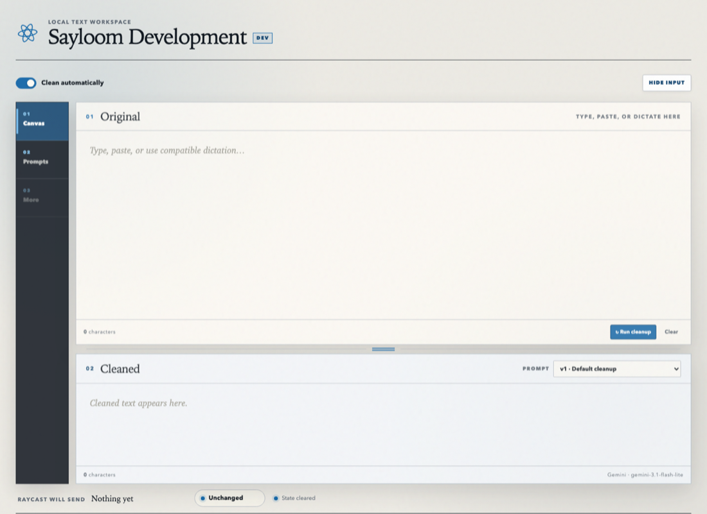

# Sayloom Development

This repository contains the current local Sayloom implementation. It accepts
Voiceitt-generated, typed, or pasted text; provides an editable Original and a
source-preserving Prepared result; fails open to Original; and publishes the
selected outgoing value for local Raycast delivery.

The current implementation is one stage of the product described in
[`PRODUCT.md`](PRODUCT.md), the sole authority for Sayloom's purpose, audience,
positioning, roadmap direction, and feature scope. In particular, the intended
product repairs likely Voiceitt word-recognition errors and calls its generated
result **Prepared**. Smart correction, review of meaning-bearing changes,
user-scoped personalization, and hosted operation are not implemented in this
checkout.

The [evaluation and Smart MVP map](docs/evaluation-mvp-map.md) records the current milestone order
and keeps the cleanup and Smart benchmark tracks independent.

The Python package and machine-level identifiers are deliberately neutral and
independent of the display brand.



## Development states

Requirements: macOS, Python 3.12+, and [uv](https://docs.astral.sh/uv/).

```sh
uv sync --locked
scripts/dev.py init
scripts/dev.py
```

Every checkout has one named external state. Commands infer it from the current
checkout, so routine use requires no `--state` argument. `init` creates a missing
state, names it from the sanitized Git branch, allocates an available loopback
port, then explicitly migrates and seeds its database. `create [NAME]` remains
available when an uninitialized state, custom name, or `--port` is required.
No command falls back to shared operating data.

Running `scripts/dev.py` without a command reports the current checkout's state,
configuration, schema, service, and port. `restart` verifies the repository,
backs up and initializes the database, then restarts only this checkout's
state-scoped service. Multiple checkout states may run concurrently on their
persisted ports. Missing, changed, cross-checkout, duplicate, and path-escaping
manifests are rejected before use.

Use `scripts/dev.py logs` to show the last 100 lines from both `service.log` and
`service-error.log` for this checkout's registered state. `-n LINES` and
`--lines LINES` change the positive line count; equivalent `-f` and `--follow`
options continue showing appended output until interrupted. The streams receive
neutral labels, valid JSON entries are indented for readability, and private
filesystem paths are never printed. The command never falls back to another
checkout or stable application state and fails without displaying log content
when the selected files are unavailable. It only presents content already in
those external logs and does not change log format, retention, redaction, or
destination.

For provider troubleshooting, run `scripts/dev.py logs --provider-traffic`.
This creates a temporary, state-scoped diagnostic session and follows both log
streams until interrupted. **While active, the logs contain the exact Gemini or
OpenAI request JSON—including the actual dictated/transcribed text and cleanup
prompt—and the exact response body, including error bodies.** They do not contain
request headers, authorization values, API keys, or credential-bearing URLs.
Press Ctrl-C as soon as diagnosis is complete; the opt-in is removed when the
viewer exits. Runtime enables diagnostics only while the viewer holds an
exclusive lock, so an unlocked marker left by a killed viewer—or marker content
that happens to match a reused process ID—cannot reactivate logging. The next
session safely reclaims an unlocked marker. The diagnostic switch cannot be
persisted in a development environment file and is unavailable in the release
profile. After the development service has been restarted once onto code
containing this feature, starting or stopping a diagnostic session requires no
further restart.

Raycast continues to use `127.0.0.1:7523`. Run `scripts/dev.py activate` to move
the current checkout to that port and atomically repoint each installed managed
Raycast alias to that checkout; the previous owner moves to the current
state's old port. Alias conflicts are rejected before state changes. Production
remains separate on reserved port 7532. Use
`scripts/dev.py list` to inspect every registration, `remove` to delete the
current checkout's external state after confirmation, and `prune` to preview
Supacode-archived worktrees in this Git repository plus states whose checkout
no longer exists and has no Supacode registration. `prune --apply` stops any Amp
runner bound to each reported checkout, deletes archived worktrees through
Supacode, and removes every associated state directory, including its
environment. Primary, pinned, unpinned, foreign-repository, and unregistered
worktrees are never prune candidates.
The tracked `supacode.json` runs `init` after Supacode creates a worktree, maps
its repeatable run command to the controlled `restart`, and runs
`remove --all --yes` only before deletion. Reversible archive leaves state
intact, and a cleanup failure blocks deletion. Existing worktrees can run
`scripts/dev.py init` once after receiving this revision; they also need the
revision before their services can use ports other than 7523 because each plist
executes that worktree's own runtime scripts.

The local default is the `development` profile and displays **Sayloom Development**. A release process can explicitly select release branding with `LOCAL_TEXT_PROFILE=release`. Application startup performs no database migrations or seed writes. If the database is absent or at the wrong schema revision, `/health` reports `setup_required` with HTTP 503 rather than changing it.

## Participant-package administration (temporary)

The participant package lives at the absolute, user-owned external directory configured by
`LOCAL_TEXT_EVIDENCE_PACKAGE_DIRECTORY`, outside Git and
application state. Only the explicit administration script can create or approve it. Create the
package, then approve the exact manifest digest returned by that command; the readiness response is
content-free and never returns the package path. The script reads
`LOCAL_TEXT_EVIDENCE_PACKAGE_DIRECTORY` from this checkout's development environment file; it does
not need to be exported in the invoking shell.

```sh
scripts/dev.py evidence-package create
scripts/dev.py evidence-package approve DIGEST
scripts/dev.py evidence-package ready
```

The browser and normal application runtime do not use or expose the package. Package creation,
validation, and administration remain temporarily for removal in issue #143. Package artifacts use
owner-only permissions, create-exclusive writes, and immediate reread/hash verification.

The provider-free [automatic-strategy evaluation harness](docs/automatic-strategy-evaluation-harness.md)
is the current Smart evaluation contract. It supersedes the historical fixed
2 × 2 × 2 [Smart correction benchmark scaffold](docs/archive/correction-benchmark-pipeline.md)
for prototype acceptance. It remains independent of the retired Cleanup
benchmark toolchain; archived Cleanup evidence does not validate Smart
correction or authorize a private run.

## Cleanup providers

Cleanup is enabled by default for every Original update, regardless of whether it came from typing, ordinary paste, or compatible dictation. Replacing a fully selected Original clears the previous Prepared result for the new session; incremental input keeps the last result visible while cleanup is waiting or running. During either kind of reprocessing, outgoing state immediately fails open to the current Original text. Reloading the page clears both editors and the process-local outgoing state without changing durable prompt or cleanup settings. Dictation tools that signal a write with an untrusted synthetic paste followed by a trusted input event receive compatible caret and focus handling, but that event sequence is not a required input API.

The fixed cleanup contract permits capitalization, punctuation, apostrophe, and
whitespace normalization while preserving every lexical word in source order,
including fillers such as `erm`, `hmm`, `uh`, and `um`. Instruction-following,
added wording, substitutions, duplication, reordering, and word removal are
rejected locally and fail open to Original. Configured prompt
versions provide guidance only within this fixed boundary; broader grammar,
tone, or wording rewriting is not a current cleanup mode.

Development configuration uses one shared file and an optional state-specific
file inside the external state directory:

```text
~/.config/local-text/development/environment
~/Library/Application Support/local-text/dev-states/STATE_NAME/environment
```

The shared file is loaded first. The state-specific file is loaded second and
may override shared values. Existing state-specific files under the former
`~/.config/local-text/development/states/` layout remain readable and move into
the state directory on the next `init` or `restart`. Status prints the exact
paths and a sanitized effective result without displaying credential values.
Each file uses unquoted `KEY=value` entries:

```sh
LOCAL_TEXT_GEMINI_API_KEY=replace-with-your-key
# Optional legacy Gemini-only settings:
# LOCAL_TEXT_GEMINI_MODEL=gemini-3.5-flash
# LOCAL_TEXT_CLEANUP_TIMEOUT_SECONDS=30
```

With no cross-provider settings, this remains the compatible Gemini-only route:
the selected Gemini model followed by `gemini-2.5-flash` within the existing
30-second total deadline. Existing `GEMINI_API_KEY` and `GOOGLE_API_KEY` values
remain compatible with that legacy route.

Cross-provider fallback is activated only by this complete, exact contract:

```sh
LOCAL_TEXT_CLEANUP_ROUTE_ORDER=gemini,openai
LOCAL_TEXT_GEMINI_API_KEY=replace-with-paid-gemini-key
LOCAL_TEXT_GEMINI_MODEL=gemini-3.7-flash
LOCAL_TEXT_GEMINI_QUOTA_GROUP_ID=gemini-paid-project
LOCAL_TEXT_OPENAI_API_KEY=replace-with-paid-openai-key
LOCAL_TEXT_OPENAI_MODEL=gpt-5.6-luna
LOCAL_TEXT_OPENAI_QUOTA_GROUP_ID=openai-paid-project
LOCAL_TEXT_CLEANUP_PAID_DATA_ACKNOWLEDGEMENT=paid-external-cleanup-v1
# Optional:
# LOCAL_TEXT_CLEANUP_TIMEOUT_SECONDS=30
```

The quota-group identifiers must be valid technical identifiers and must differ.
Any missing, invalid, or unacknowledged cross-provider setting disables every
provider client and preserves Original fail-open. Generic `OPENAI_API_KEY` is
never used. Arbitrary provider endpoints, route orders, and production model IDs
are not supported.

The Workspace's expandable **Cleanup route** disclosure and the sanitized
`cleanup_configuration` object in `/health` and `/api/config` report the active
status and provider/model order without credentials. Cross-provider cleanup sends
the current text and cleanup instruction to paid Gemini. Only after a qualifying
Gemini failure may it send the same current text and instruction to paid OpenAI.
Routine cleanup does not retain Original, Prepared, or provider payloads.

Create the shared file with an editor so the credential does not enter shell
history or command arguments:

```sh
install -d -m 700 "$HOME/.config/local-text/development"
"${EDITOR:?Set EDITOR first}" "$HOME/.config/local-text/development/environment"
chmod 600 "$HOME/.config/local-text/development/environment"
scripts/dev.py restart
```

The files and keys must never enter Git. Only the cleanup keys shown above are
accepted; files must be regular, non-symlink files with mode `0600`, are parsed
as data, and are never sourced as shell code. Database path, state directory,
profile, service label, and port overrides are rejected: those runtime values
remain exclusively bound by the selected state manifest.

## Durable prompt configuration

SQLite in the external profile state directory is authoritative for the seeded prompt, immutable custom prompt versions, exact durable default selection, the cleanup default, target definitions and target-operation errors, seed state, and one-time import status. Workspace cleanup requests omit a page-session prompt override, so the server resolves the durable active prompt and returns its exact ID and content hash. Every active prompt is wrapped in the fixed source-preserving product contract before it is sent to a provider, so neither a legacy seed nor a custom version can widen accepted output. Expanded prompt management is intentionally outside the Workspace surface.

The **Settings** destination places the persisted default correction mode before durable target management. The saved correction default is snapshotted when the next Original begins; changing it does not reprocess or change the active draft. Conservative results offer a one-shot **Run Smart correction** action, while a Smart default runs automatically without a redundant action. Settings manages target definitions for Amp, iTerm, Supacode, and VS Code plus bounded user-authored targets. **Save definition** never installs. **Install/Regenerate command** explicitly writes one generated command to the configured Raycast Script Commands directory, and Disable/Remove state their command-removal consequences. Generated commands consume only the current outgoing-state API, never press Return, and leave hotkey assignment to Raycast and the user. Application and macOS permission state remains **Not verified** until it is exercised on the Mac that runs Raycast. The fixed **Dev: Open Sayloom** command and four fixed Gate 1 send commands remain available during managed-command verification.

Original and Prepared default to resizable stacked panes and can switch to a resizable side-by-side layout on wide viewports. Layout, divider positions, and the collapsible navigation rail are local browser preferences; pane maximization is temporary, and narrow viewports enforce stacking without changing the saved desktop preference. Both dividers support pointer and keyboard adjustment, and the editors scroll independently. Original uses the browser's native insertion point; Prepared is read-only. The compact Outgoing status bar explicitly selects Prepared or Original and expands to show route details. Prepared becomes the default after a current successful cleanup; pending, stale, disabled, timed-out, and failed cleanup states fall back to Original, and an explicit per-draft Original selection survives reruns until Clear or reload. Cleanup and publication failures provide persistent, expandable, copyable safe details without including operating text, provider payloads, credentials, stack traces, or private paths.

Cleanup details distinguish provider authentication/access rejection, quota or rate limits, provider service errors, other HTTP rejection, transport failure, timeout, malformed provider responses, and output rejected by provider or local safety checks. The attempted model and provider HTTP status are included when available. Cleanup uses `gemini-3.5-flash` by default and makes one bounded `gemini-2.5-flash` fallback attempt after HTTP 429 or 503; a five-minute per-model cooldown prevents automatic cleanup from repeatedly hitting a transiently failing model. The cleanup timeout remains the total deadline, and every exhausted path still fails open to Original. Normal server logs record only structured provider/model, category/status, duration, and input-length metadata; they never record operating text, prompts, credentials, headers, or provider payloads. The temporary development-only provider traffic session documented above is the explicit exception for request payloads and response bodies; it still never records credentials or headers.

Normal startup only checks schema state. Development-state administration is explicit:

```sh
scripts/dev.py db
scripts/dev.py db migrate
scripts/dev.py db seed
scripts/dev.py init
```

Use `scripts/dev.py restart` for a real update rather than running
migration steps individually. It runs all checks, makes an online SQLite backup,
migrates, applies the deterministic seed release, and restarts only the current
checkout's state-scoped service.

### One-time configuration import

The importer reads an explicitly supplied directory and never discovers, modifies, or deletes a source. Only these optional files are allowlisted:

- `cleanup-prompt.txt`: UTF-8 cleanup instruction, imported as a new active immutable version.
- `preferences.json`: a JSON object whose only supported key is the boolean `cleanup_enabled_by_default`.

Other files—including databases, history, text content, diagnostics, logs, and recordings—are ignored. Preview prints the exact imported values and a confirmation digest:

```sh
scripts/dev.py db import-preview /path/to/configuration-directory
scripts/dev.py db import-confirm /path/to/configuration-directory \
  --digest COPY_THE_PREVIEW_DIGEST_HERE
```

Confirmation rereads the allowlisted source and rejects a stale digest. The write is one transaction, records completion, and rejects every later import attempt.

## Development

```sh
uv run ruff check .
uv run pytest
```

Do not use hot reload for validated coding tasks. Use the controlled
`scripts/dev.py restart` workflow described above.

## State-scoped launchd service

Render a selected state's plist for review without changing machine state:

```sh
uv run python scripts/render-launchd-plist.py \
  --state feature-workflow > /tmp/local-text-development.plist
plutil -lint /tmp/local-text-development.plist
```

`restart` installs or reloads only the current checkout state's user agent. Runtime logs
and all future operating data belong in that external state directory, never in
this repository.

End-user Preferences and Keychain-backed credential management are deferred;
this developer-safety gate intentionally provides no Preferences or Keychain UI.

## Raycast commands

Install development-prefixed aliases in Raycast's default Script Commands directory:

```sh
scripts/install-raycast.py
```

Pass `--directory PATH` to select another directory. The installer links the five
Raycast commands rather than copying them, prefixes their filenames with `dev-`,
is safe to run again, recovers its broken managed aliases after a disposable
checkout is removed, and refuses to replace an existing file or unrelated link.
The aliases target whichever development state currently owns port 7523; use
`scripts/dev.py activate` from a checkout to change that state and repoint the
installed aliases to its scripts. They provide
exactly five user-facing commands:

- **Dev: Open Sayloom**
- **Dev: Send to Amp**
- **Dev: Send to iTerm**
- **Dev: Send to Supacode**
- **Dev: Send to VS Code**

Raycast owns global hotkeys; no hotkey values are committed. Assign the familiar hotkeys to these development-branded commands in Raycast settings. Send commands refuse empty, malformed, or unavailable outgoing state and never press Return. Amp, Supacode, and VS Code use a Sticky-Keys-safe synthetic paste and restore the prior text clipboard. iTerm inserts multiline text directly without using the clipboard.

The five Gate 1 command surfaces remain intact through the durable prompt core. Real-device Gate 2 verification adds prompt-history rendering, new-version activation, exact rollback to an earlier version, cleanup with the selected version, durable cleanup-toggle state, controlled backup/migrate/restart health, and one-time importer preview/confirm behavior.

## Privacy

Never commit credentials, API keys, dictated or prepared text, databases, logs, local `.env` files, or machine-specific paths. Use synthetic text in tests and documentation.
